<div align="center">


# UptimeHQ

**Website and API uptime monitoring: checks every 5 seconds, incidents, email alerts and response-time history.**


[](https://github.com/ashutosh-lodha/UptimeHQ/actions/workflows/ci.yml)


</div>

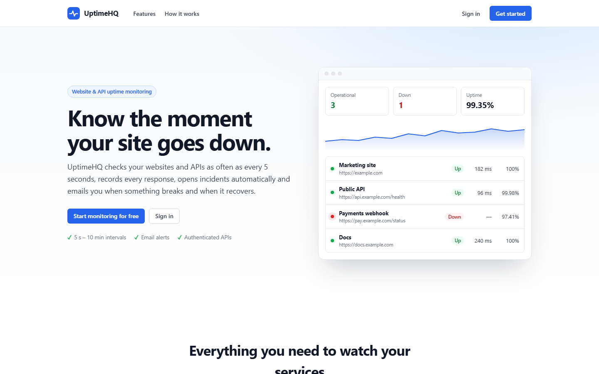

UptimeHQ is a self-hosted, full-stack uptime monitor. Add any HTTP(S) website or API, public or protected by credentials, and UptimeHQ checks it on a schedule from a background worker. It records every response, opens an incident the moment a check fails, resolves it on recovery, and emails you at both transitions.

It is built as a small production system rather than a demo: separate API, worker and scheduler processes, a job queue, transactional incident handling, encrypted secrets, SSRF protection, network isolation, automated tests and CI, and a documented single-VM deployment with HTTPS.

---

## Contents

- [Features](#features)
- [What it detects](#what-it-detects)
- [Screenshots](#screenshots)
- [Architecture](#architecture)
  - [System overview](#system-overview)
  - [Services](#services)
  - [Network isolation](#network-isolation)
  - [Sign-in and API authentication](#sign-in-and-api-authentication)
  - [The check pipeline](#the-check-pipeline)
  - [Monitor status and incidents](#monitor-status-and-incidents)
  - [Email alerts](#email-alerts)
  - [SSRF protection](#ssrf-protection)
  - [Data model](#data-model)
  - [Data retention and disk usage](#data-retention-and-disk-usage)
- [Authenticated monitors](#authenticated-monitors)
- [Security](#security)
- [Tech stack](#tech-stack)
- [Project structure](#project-structure)
- [Getting started](#getting-started)
- [Configuration](#configuration)
- [Clerk setup](#clerk-setup)
- [Email with Resend](#email-with-resend)
- [Testing and CI](#testing-and-ci)
- [Production deployment](#production-deployment)
- [API reference](#api-reference)
- [Known limitations](#known-limitations)

---

## Features

| Area | What you get |
| --- | --- |
| **Monitoring** | HTTP(S) checks with `GET` or `HEAD` every **5 s, 10 s, 30 s, 1 min, 5 min or 10 min**. Configurable timeout (up to the interval) and expected status range. Pause, resume, edit and delete. The first check runs immediately after creation. |
| **Results** | Every check stores status code, response time, outcome and error. Outcomes are classified as `SUCCESS`, `HTTP_STATUS_FAILURE`, `TIMEOUT`, `NETWORK_ERROR`, `AUTHENTICATION_FAILED` (401), `AUTHORIZATION_FAILED` (403) or `TOKEN_ACQUISITION_FAILED`. |
| **Incidents** | An incident opens on the first failed check and resolves on the first successful one, with cause, start, end and duration. Exactly one open incident per monitor, enforced by the database. |
| **Alerts** | One email when a service goes down and one when it recovers, sent via any SMTP provider (e.g. Resend), retried with exponential backoff, never duplicated. Per-user settings for recipient and alert types. |
| **Dashboard** | Totals, overall uptime, average response time chart and recent incidents over 24 h, 7 d or 30 d. |
| **Monitor page** | Live status, uptime, response-time chart, **paginated check history** with an All/Failed filter, incidents and configuration. |
| **Protected APIs** | Bearer token, Basic auth, API key header, custom headers or OAuth2 client credentials. Secrets are encrypted with AES-256-GCM and never returned by the API. |
| **Accounts** | Sign-up and sign-in with [Clerk](https://clerk.com) (email or Google). Every API request carries a Clerk session JWT verified locally (RS256). |
| **Safety** | SSRF protection on every request and redirect hop, rate limiting, strict security headers, isolated database network, and data retention that keeps the disk from filling up. |
| **UI** | Public landing page, responsive layout from phones to wide monitors (tables become cards on small screens), plain CSS with no UI framework. |

---

## What it detects

Every failed check is classified, so an alert says *why* a service is down, not just that it is.

| Failure | Recorded as | In one line |
| --- | --- | --- |
| Server errors (5xx) | `HTTP_STATUS_FAILURE` | 500, 502, 503 or 504 from a crashed app, a bad deploy or an overloaded backend. |
| Unexpected status codes | `HTTP_STATUS_FAILURE` | A 404, 410 or any code outside the range you marked as healthy. |
| Redirect loops | `HTTP_STATUS_FAILURE` | A URL that keeps redirecting instead of ever returning a page. |
| Slow or hanging responses | `TIMEOUT` | No response within your timeout, or a connection that never completes. |
| Connection refused or reset | `NETWORK_ERROR` | Nothing listening on the port, or the server drops the connection. |
| DNS failures | `NETWORK_ERROR` | The domain stops resolving, has expired or its records are misconfigured. |
| Host unreachable | `NETWORK_ERROR` | The server or its network is offline and cannot be routed to. |
| SSL/TLS certificate problems | `NETWORK_ERROR` | Expired, self-signed or wrong-hostname certificates that browsers would reject. |
| Unsafe destinations | `NETWORK_ERROR` | URLs that resolve to private or internal addresses are refused, never fetched. |
| Rejected credentials (401) | `AUTHENTICATION_FAILED` | Your API key, token or password stopped working or was revoked. |
| Access denied (403) | `AUTHORIZATION_FAILED` | The endpoint answers but refuses the monitor access. |
| OAuth2 token failures | `TOKEN_ACQUISITION_FAILED` | The token server is down or rejects the client ID and secret. |

### How an incident works

1. **Scheduled check:** a background worker requests your URL on your interval, from 5 seconds to 10 minutes.
2. **Classified result:** every response is recorded with its status code, response time and failure type.
3. **Incident opened:** the first failed check opens an incident and sends a "down" email right away.
4. **Tracked while down:** further failures stay in the same incident, so you get one alert, not a flood.
5. **Resolved on recovery:** the first successful check closes the incident, records its duration and sends a recovery email.

---

## Screenshots

| Landing page | Sign in (Clerk) |
| --- | --- |
|  | 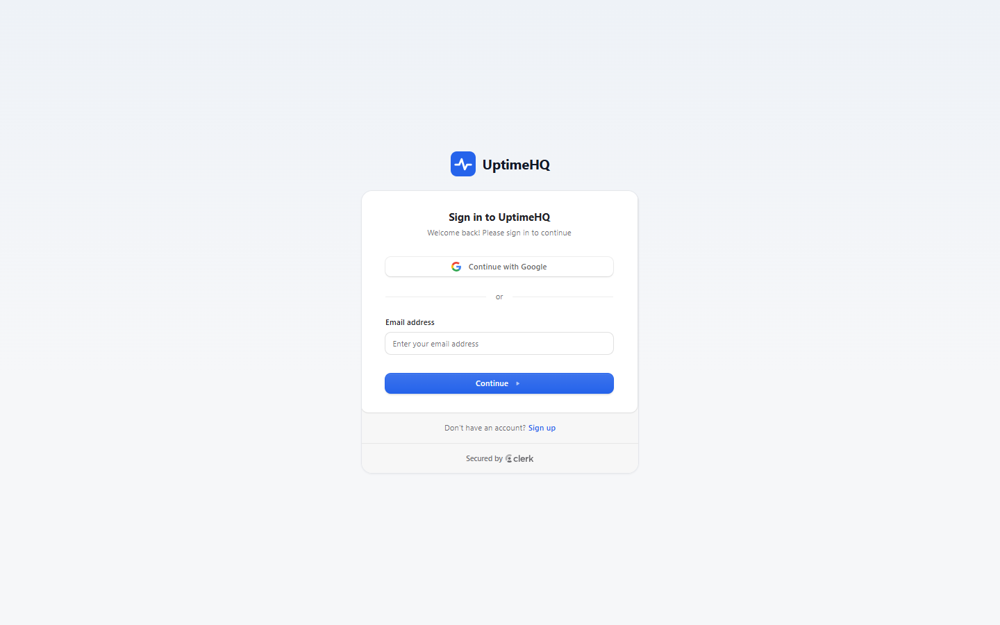 |

| Landing on a phone | Sign in on a phone | Full landing page |
| --- | --- | --- |
| 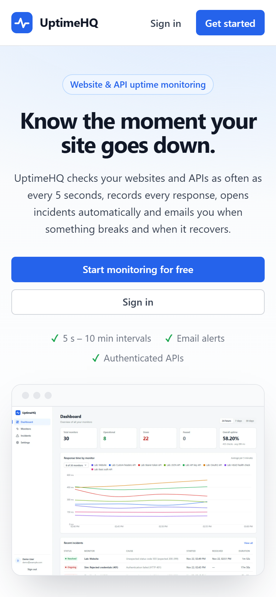 | 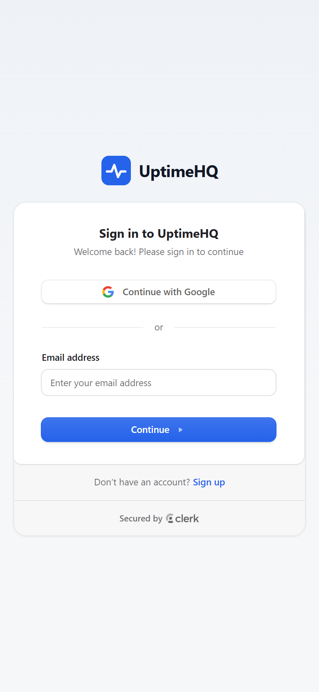 | 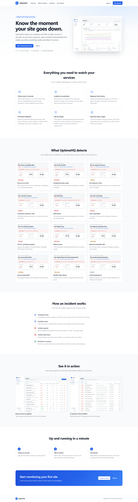 |

---

## Architecture

### System overview

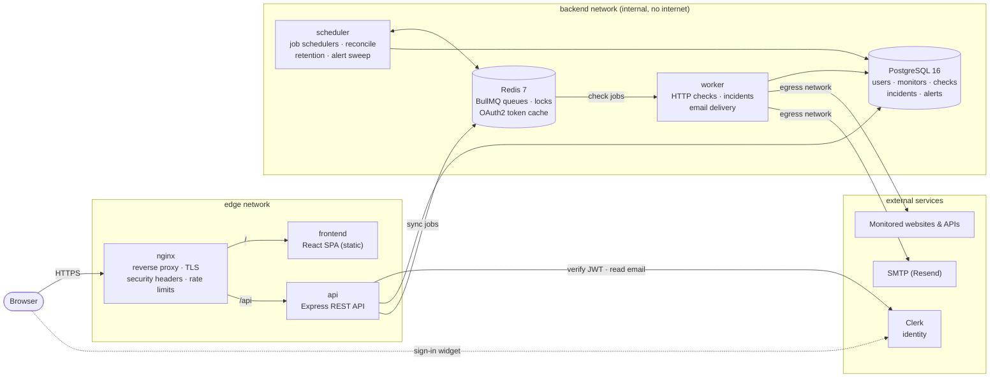

The API never performs checks. It stores configuration and tells the scheduler that something changed. The scheduler turns each enabled monitor into a recurring BullMQ job. Workers execute the jobs, write results and incident transitions in one transaction, and send emails. Each process can be restarted or scaled on its own.

### Services

All seven services run from one `docker-compose.yml`. The `api`, `worker` and `scheduler` share one backend image and differ only in the command they run.

| Service | Image | Responsibility |
| --- | --- | --- |
| `nginx` | `nginx:1.27-alpine` | The only service with published ports (80/443). Routes `/api` to the API and everything else to the frontend. Adds CSP, HSTS (HTTPS mode) and other security headers. Rate limits `/api/auth` (10 req/min per IP) and `/api` (20 req/s per IP). Serves Let's Encrypt challenges. |
| `frontend` | built from `frontend/` | Static React build served by unprivileged NGINX. |
| `api` | built from `backend/` | Clerk JWT verification, user provisioning, monitor CRUD (including credential encryption), incidents, dashboard aggregates and settings. Applies Prisma migrations on start. |
| `scheduler` | backend image | Keeps exactly one BullMQ job scheduler per enabled monitor, handles `sync` jobs from the API, reconciles Redis with PostgreSQL every 60 s, re-queues unsent alerts and deletes check records older than the retention window. |
| `worker` | backend image | Runs checks (concurrency 10 by default) and email deliveries. |
| `postgres` | `postgres:16-alpine` | System of record. Internal network only. |
| `redis` | `redis:7-alpine` | Queues, per-monitor locks and the OAuth2 token cache (AOF persistence). Internal network only. |

Every service has a health check and `restart: unless-stopped`. The worker and scheduler write a heartbeat file that their health check reads, so a stuck process is reported as unhealthy.

### Network isolation

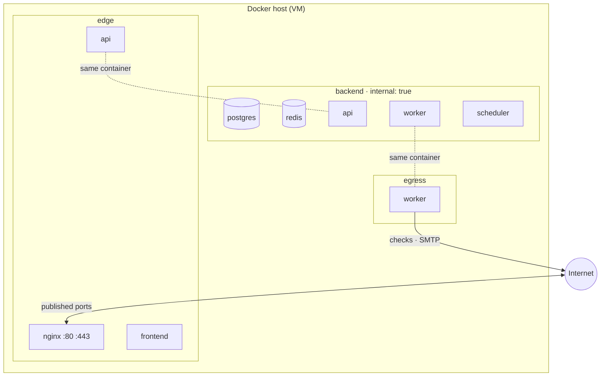

- `backend` is an **internal** Docker network: PostgreSQL and Redis have no published ports and no route to or from the internet.
- Only `nginx` publishes ports. The API is reachable only through it.
- Only the `worker` joins the `egress` network, because it is the only process that must reach the outside world (monitored URLs and SMTP).

### Sign-in and API authentication

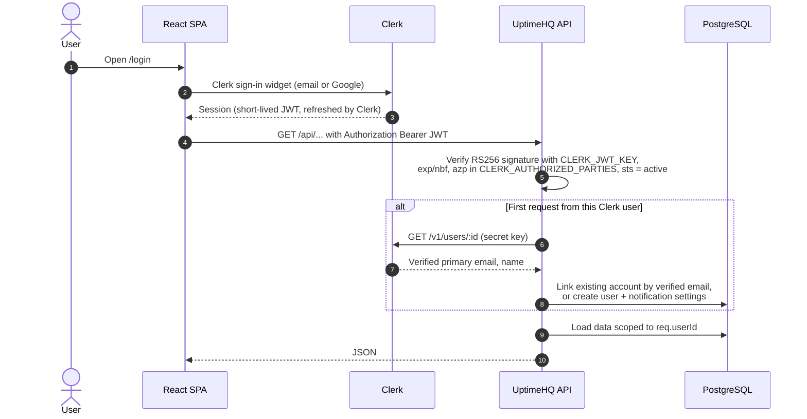

- The API never sees passwords. It accepts only Clerk session JWTs and verifies them **locally** with Clerk's public key, so there is no network call per request.
- HS256, unsigned and wrong-audience tokens are rejected (covered by tests).
- Users are created on their first request, from the **verified** email Clerk reports. Accounts that existed before Clerk was introduced are linked by that email, so their monitors are kept.
- Every query is scoped to the signed-in user. Resources owned by someone else return `404`.

### The check pipeline

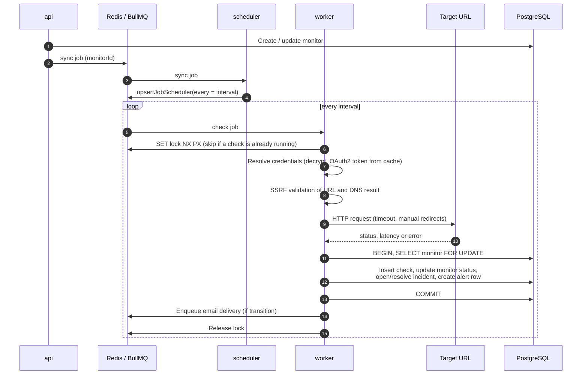

Design points:

- **No overlapping checks.** A per-monitor Redis lock (`SET NX PX`, compare-and-delete release) means a slow endpoint never stacks up checks.
- **Self-healing schedules.** Every 60 s the scheduler compares Redis with PostgreSQL and adds or removes job schedulers, so schedules survive Redis restarts and missed sync jobs.
- **Immediate first check.** Creating or editing a monitor queues one immediate check, de-duplicated per monitor.
- **Bounded queues.** Completed jobs are kept for 1 hour (max 1,000), failed jobs for 24 hours (max 5,000).

### Monitor status and incidents

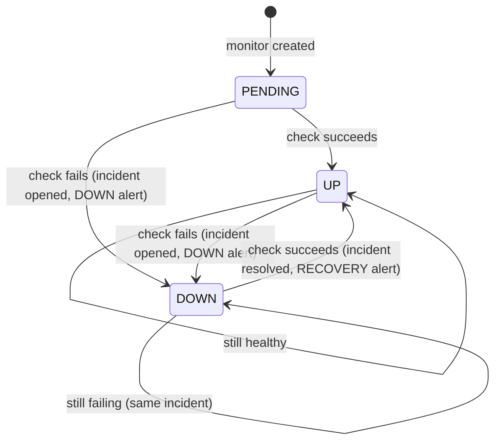

Correctness is enforced in the database, not only in code:

- Results are applied inside a transaction that locks the monitor row (`SELECT … FOR UPDATE`), so two concurrent results can't both open an incident.
- A partial unique index (`Incident_one_open_per_monitor`) allows **at most one open incident per monitor**.
- A unique key on `(incidentId, type)` allows **at most one DOWN and one RECOVERY alert per incident**.
- Pausing a monitor stops its schedule; results that arrive for a paused monitor are discarded.

### Email alerts

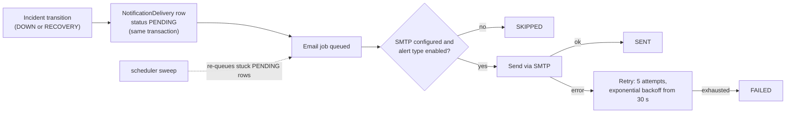

Because the delivery row is written in the same transaction as the incident, an alert can't be lost if the process dies right after committing: the scheduler's sweep re-queues anything still `PENDING`. Recent deliveries and their status are shown on the Settings page.

### SSRF protection

A monitoring service fetches URLs chosen by users, which makes it a natural target for Server-Side Request Forgery. Every target URL and OAuth2 token URL goes through this check when it is saved, before every request, and on every redirect hop:

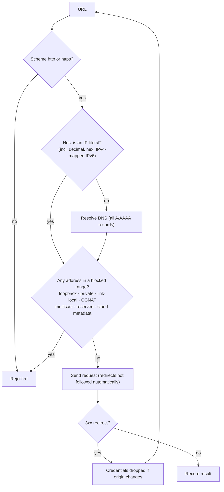

### Data model

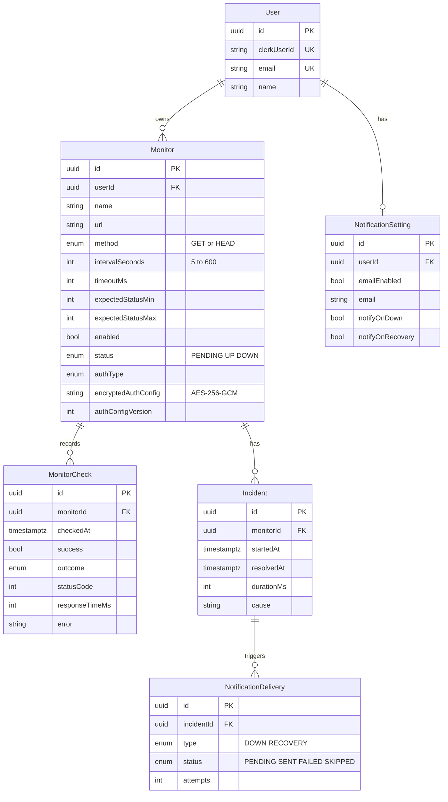

Indexes cover the hot paths: `MonitorCheck(monitorId, checkedAt DESC)` for history and charts, `MonitorCheck(checkedAt)` for retention, `Incident(monitorId, startedAt DESC)`, plus the uniqueness rules above. Charts are aggregated in SQL into fixed buckets: 5 minutes for 24 h, 1 hour for 7 d and 6 hours for 30 d.

### Data retention and disk usage

A monitor checked every 5 seconds produces about 17,000 rows a day, so storage is bounded deliberately:

| What | How it is bounded |
| --- | --- |
| Endpoint check records | The scheduler deletes checks older than `CHECK_RETENTION_DAYS` (default **30 days**, matching the longest chart range) every 6 hours, in batches of 5,000 so a large backlog never locks the table. Incidents are kept. |
| Container logs | Every service uses Docker's `json-file` driver rotated at 10 MB × 3 files, compressed: at most about 30 MB per service. |
| Queue data | Finished BullMQ jobs are trimmed automatically (see above). |
| Old images and build cache | A weekly cron on the server removes anything unused for 30 days (see [deployment](#disk-housekeeping)). |

---

## Authenticated monitors

Monitor private endpoints by choosing an **Authentication** method in the monitor form:

| Method | You provide | Sent with each check |
| --- | --- | --- |
| None | Nothing | Nothing |
| Bearer Token | An existing JWT or access token | `Authorization: Bearer <token>` |
| Basic Authentication | Username and password | `Authorization: Basic base64(user:pass)` |
| API Key | Header name and key | `<Header-Name>: <key>` (header only: query-string keys leak into logs) |
| Custom Headers | Up to 20 header names and values | Each header as given |
| OAuth2 Client Credentials | Client ID, secret and token URL | `Authorization: Bearer <access_token>`, fetched and cached automatically |

**OAuth2 client credentials flow:**

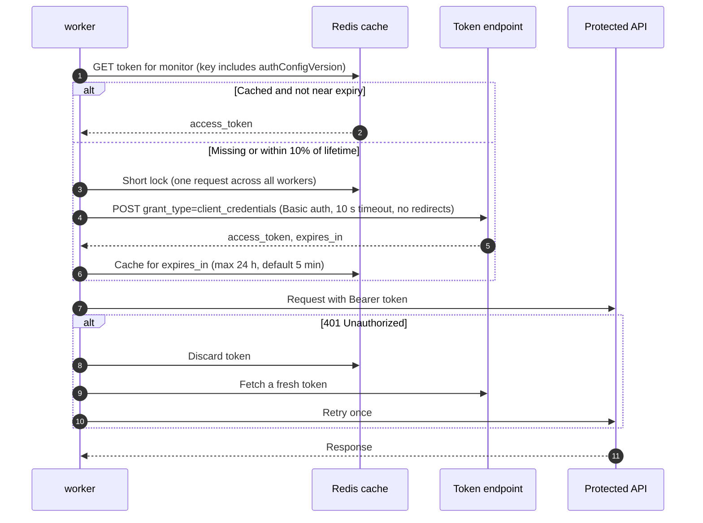

Rules:

- Monitors with credentials must use **HTTPS**, and the token URL must be HTTPS and pass the SSRF checks.
- `401` and `403` always count as failures when credentials are attached. Only a `401` triggers a token refresh and one retry.
- Credentials are **never forwarded to a different origin** on redirect, including an HTTPS→HTTP downgrade.
- `Host`, `Content-Length`, `Connection`, `Transfer-Encoding`, `Authorization`, and any `Proxy-*` or `Sec-*` header can't be set as custom headers.
- Saved secrets are never sent back to the browser. The edit form shows **Credentials configured** with **Replace** and **Remove** actions. Changing credentials bumps `authConfigVersion`, which invalidates cached OAuth2 tokens.
- Only the OAuth `error` code (such as `invalid_client`) is recorded on failure, never the response body.

**Encryption at rest.** Credentials are stored as `v1:<iv>:<tag>:<ciphertext>` using AES-256-GCM with a fresh 12-byte IV per write. The additional authenticated data is bound to the monitor ID, so a ciphertext copied to another monitor won't decrypt. The key (`MONITOR_CREDENTIAL_ENCRYPTION_KEY`) lives only in the environment.

- Without the key, everything works except saving credentials: the API answers `503` and the form shows a warning. Nothing is ever stored in plaintext.
- If the key is lost, affected monitors report `AUTHENTICATION_FAILED` until credentials are re-entered. Back the key up separately from database backups.

Example payload for the API:

```json
{ "name": "Orders API", "url": "https://api.example.com/health", "intervalSeconds": 60,
  "auth": { "type": "OAUTH2_CLIENT_CREDENTIALS", "tokenUrl": "https://auth.example.com/oauth/token",
            "clientId": "uptime-monitor", "clientSecret": "example-secret" } }
```

On `PATCH /api/monitors/:id`, omit `auth` to keep credentials, send a new `auth` object to replace them, or send `{ "type": "NONE" }` to remove them.

---

## Security

| Threat | Mitigation |
| --- | --- |
| Account takeover / token forgery | Clerk-hosted sign-in; RS256 JWTs verified locally with pinned algorithm, `azp` allow-list and active-session check |
| Accessing other users' data | Every query is scoped by user ID; foreign IDs return `404` |
| SSRF via monitored URLs or token URLs | Scheme allow-list, DNS + IP range validation before every request and redirect hop, cloud metadata blocked |
| Credential leakage | AES-256-GCM at rest, never returned by the API, never logged, never forwarded cross-origin, HTTPS required |
| Header injection | Header names validated as HTTP tokens; line breaks rejected; restricted headers blocked |
| Brute force / abuse | NGINX rate limits on `/api/auth` and `/api` |
| XSS / clickjacking | Strict Content-Security-Policy, `X-Frame-Options`/`frame-ancestors 'none'`, `nosniff`, referrer policy |
| Database exposure | PostgreSQL and Redis on an internal network with no published ports |
| Duplicate alerts / races | Row lock, partial unique index and unique delivery key |
| Disk exhaustion | 30-day check retention, capped container logs, image pruning |
| Vulnerable dependencies | `npm audit` clean for backend and frontend at the time of writing |

---

## Tech stack

| Layer | Technology |
| --- | --- |
| Backend | Node.js 22, TypeScript, Express 5, Zod 4 validation |
| Database | PostgreSQL 16 with Prisma 6 (schema + SQL migrations) |
| Jobs | BullMQ on Redis 7 (job schedulers, retries, de-duplication) |
| HTTP checks | Native `fetch` with manual redirect handling |
| Auth | Clerk (`@clerk/react` in the SPA, `jsonwebtoken` RS256 verification in the API) |
| Email | Nodemailer over SMTP (Resend in production) |
| Frontend | React 18, Vite, Recharts, plain CSS, a ~70-line History API router |
| Testing | Vitest, Supertest, real PostgreSQL and Redis |
| Delivery | Docker, Docker Compose, NGINX, Let's Encrypt, GitHub Actions (CI + SSH deploy) |

---

## Project structure

```
.
├── backend/
│   ├── prisma/
│   │   ├── schema.prisma            # data model
│   │   └── migrations/              # SQL migrations (applied on API start)
│   ├── src/
│   │   ├── server.ts                # API process
│   │   ├── worker.ts                # check + email worker process
│   │   ├── scheduler.ts             # scheduling, reconciliation, retention
│   │   ├── app.ts                   # Express app factory
│   │   ├── config.ts                # validated environment
│   │   ├── middleware/auth.ts       # Clerk JWT auth + user provisioning
│   │   ├── modules/                 # auth, monitors, incidents, dashboard, settings
│   │   ├── monitoring/              # httpCheck, ssrf, runCheck, incidentEngine,
│   │   │   │                        # scheduling, redisLock
│   │   │   └── auth/                # credential crypto, providers, OAuth2, token cache
│   │   ├── notifications/           # mailer + delivery
│   │   └── queue/                   # BullMQ queues
│   └── tests/                       # Vitest + Supertest integration tests
├── frontend/
│   └── src/
│       ├── pages/                   # Landing, Dashboard, Monitors, Monitor detail,
│       │                            # Monitor form, Incidents, Settings, Auth
│       ├── components/              # Layout, charts, tables, auth fields, pager, ...
│       ├── lib/                     # router, auth bridge, formatting, hooks
│       └── styles/                  # global.css, landing.css
├── nginx/                           # reverse proxy: nginx.conf (HTTP), https.conf (template)
├── scripts/deploy.sh                # pull, rebuild, wait healthy (used by CD)
├── docs/screenshots/
├── .github/workflows/ci.yml
├── docker-compose.yml
└── .env.example
```

---

## Getting started

### Run everything with Docker Compose

Requirements: Docker with the Compose plugin, and a free [Clerk](https://clerk.com) application (see [Clerk setup](#clerk-setup)).

```bash
git clone https://github.com/ashutosh-lodha/UptimeHQ.git uptimehq && cd uptimehq
```

```bash
cp .env.example .env
```

Edit `.env` and set at least `POSTGRES_PASSWORD`, the four `CLERK_*` values and `APP_URL`. Then start the stack:

```bash
docker compose up -d --build
```

```bash
docker compose ps
```

Open `http://localhost` (or `http://localhost:<HTTP_PORT>`). The API applies database migrations automatically before it starts.

Useful commands:

```bash
docker compose logs -f api worker scheduler
```

```bash
docker compose down
```

`docker compose down -v` also deletes the database and Redis volumes.

### Local development

Requirements: Node.js 22+, plus PostgreSQL 16 and Redis 7 (for example in containers):

```bash
docker run -d --name uptimehq-pg -e POSTGRES_USER=uptimehq -e POSTGRES_PASSWORD=uptimehq -e POSTGRES_DB=uptimehq -p 5432:5432 postgres:16-alpine
```

```bash
docker run -d --name uptimehq-redis -p 6379:6379 redis:7-alpine
```

Backend setup, then one terminal per process:

```bash
cd backend && cp .env.example .env && npm install && npx prisma migrate deploy
```

```bash
cd backend && npm run dev:api
```

```bash
cd backend && npm run dev:scheduler
```

```bash
cd backend && npm run dev:worker
```

Frontend (Vite proxies `/api` to `http://localhost:4000`):

```bash
cd frontend && cp .env.example .env && npm install && npm run dev
```

Open http://localhost:5173. To change the schema, edit `backend/prisma/schema.prisma` and run `npm run migrate:dev -- --name <change>`.

---

## Configuration

All configuration comes from environment variables. For Docker Compose they live in `.env` at the repository root (copy [.env.example](.env.example)); `.env` is git-ignored.

| Variable | Required | Description |
| --- | --- | --- |
| `POSTGRES_PASSWORD` | yes | Database password (`openssl rand -hex 24`) |
| `CLERK_PUBLISHABLE_KEY` | yes | `pk_test_…` / `pk_live_…`, compiled into the frontend (public by design) |
| `CLERK_SECRET_KEY` | yes | `sk_test_…` / `sk_live_…`, used by the API to read a user's verified email once |
| `CLERK_JWT_KEY` | yes | Clerk JWT public key (PEM) on one line, line breaks written as `\n` |
| `CLERK_AUTHORIZED_PARTIES` | yes | Comma-separated origins allowed to use sessions, e.g. `https://uptime.example.com` |
| `APP_URL` | yes | Public URL, used for links in alert emails |
| `MONITOR_CREDENTIAL_ENCRYPTION_KEY` | for authenticated monitors | 32-byte key as 64 hex chars (`openssl rand -hex 32`) |
| `SMTP_HOST`, `SMTP_PORT`, `SMTP_SECURE`, `SMTP_USER`, `SMTP_PASSWORD`, `SMTP_FROM` | for email alerts | Alerts are enabled when `SMTP_HOST` and `SMTP_FROM` are set. Use `SMTP_SECURE=true` for port 465. |
| `CHECK_RETENTION_DAYS` | no | Days of check records to keep, min 30 (default 30) |
| `WORKER_CONCURRENCY` | no | Parallel checks per worker (default 10) |
| `SCHEDULER_RECONCILE_SECONDS` | no | Reconcile interval (default 60) |
| `POSTGRES_USER`, `POSTGRES_DB` | no | Default `uptimehq` |
| `HTTP_PORT`, `HTTPS_PORT` | no | Host ports for NGINX (default 80 / 443) |

Without SMTP, monitoring and incidents work normally; alerts are recorded as `SKIPPED` and the Settings page explains why.

---

## Clerk setup

1. Create an application at [dashboard.clerk.com](https://dashboard.clerk.com). Enable **email address** (required: alerts and account linking use the verified email) and optionally **Google**.
2. In **Configure → API keys** copy the **Publishable key**, the **Secret key** and the **JWT public key (PEM)** into `CLERK_PUBLISHABLE_KEY`, `CLERK_SECRET_KEY` and `CLERK_JWT_KEY`. The PEM can also be derived from your instance's `https://<frontend-api>/.well-known/jwks.json`.
3. Set `CLERK_AUTHORIZED_PARTIES` to the exact origin users open, e.g. `http://localhost:8080` locally or `https://uptime.example.com` in production.
4. **Production:** create a Clerk *production instance* for your root domain and add the DNS records Clerk lists (`clerk`, `accounts`, `clkmail` and two DKIM CNAMEs). Add the Frontend API host (e.g. `https://clerk.example.com`) to `script-src`, `connect-src` and `frame-src` in the NGINX `Content-Security-Policy`. For Google sign-in, create an OAuth client in Google Cloud and paste its ID and secret into Clerk.
5. Rebuild after changing keys (the publishable key is compiled into the frontend): `docker compose up -d --build`.

---

## Email with Resend

Any SMTP provider works. With [Resend](https://resend.com):

1. **Domains → Add domain** (a subdomain such as `uptime.example.com` keeps alert mail separate from your main domain). Add the DKIM TXT and SPF records it shows, then **Verify**.
2. **API Keys → Create** with *Sending access*.
3. In `.env`:

   ```
   SMTP_HOST=smtp.resend.com
   SMTP_PORT=465
   SMTP_SECURE=true
   SMTP_USER=resend
   SMTP_PASSWORD=re_your_api_key
   SMTP_FROM="UptimeHQ <alerts@uptime.example.com>"
   ```

4. Apply with `docker compose up -d`. Settings then shows that email is configured.

Until a domain is verified, Resend only sends from `onboarding@resend.dev` to your own account address.

---

## Testing and CI

The backend has **107 integration tests** that run against real PostgreSQL and Redis. External HTTP servers, OAuth servers, DNS, SMTP and Clerk are replaced with in-process fakes, so no network access or real credentials are needed.

| Area | Covered |
| --- | --- |
| Auth | Clerk JWT verification (forged, expired, wrong `azp`, inactive session, HS256 confusion, stripped signature), user provisioning, legacy account linking |
| Monitors | CRUD, validation, intervals, ownership isolation, pause/resume |
| Checks | Success, bad status, timeout, connection refused, DNS failure, redirects, redirect loops, outcome classification |
| Incidents | Opening, recovery, no duplicates under concurrent results, overlapping-check prevention |
| Alerts | Sending, skipping, retry, de-duplication |
| SSRF | IP ranges, IPv4-mapped IPv6, encoded IPs, hostnames, DNS results, redirects |
| Authenticated monitors | Every auth method, restricted headers, HTTPS enforcement, encryption at rest, no secrets in responses, key handling, OAuth2 caching, refresh, single-flight, 401 retry, 403 no retry |
| Data | Dashboard metrics, paginated check history, 30-day retention |

Run them locally (the tests truncate tables, so use disposable databases):

```bash
docker run -d --name uptimehq-test-pg -e POSTGRES_USER=uptimehq -e POSTGRES_PASSWORD=uptimehq -e POSTGRES_DB=uptimehq -p 54329:5432 postgres:16-alpine
```

```bash
docker run -d --name uptimehq-test-redis -p 63799:6379 redis:7-alpine
```

```bash
cd backend && npm test
```

Override the defaults with `TEST_DATABASE_URL` and `TEST_REDIS_URL`.

**CI/CD** ([.github/workflows/ci.yml](.github/workflows/ci.yml)) runs on every push to `main` and every pull request. On `main`, a passing build is deployed to production automatically:

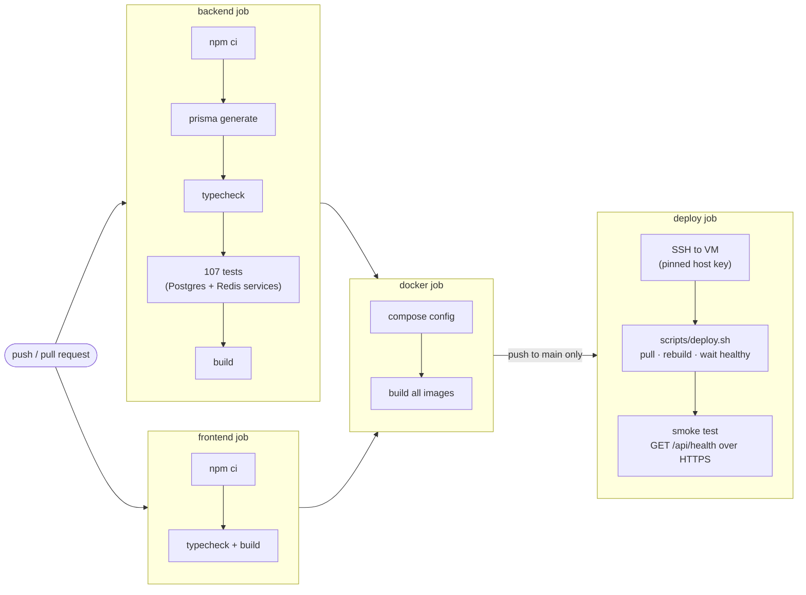

A failing test or build stops the pipeline before the deploy job, so broken code never reaches the server. Deploys never overlap: a newer push waits for the running one.

---

## Production deployment

UptimeHQ runs on a single Google Cloud VM behind HTTPS. DNS is managed at the domain registrar, identity by Clerk and email by Resend.

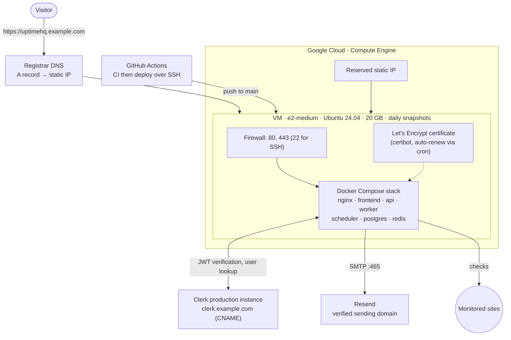

### 1. Server

- Reserve a **regional static external IP**. VMs otherwise get an ephemeral IP that changes on stop/start, like an AWS IP without an Elastic IP.
- Create the VM in the same region:
  - **e2-medium** (2 vCPU, 4 GB: the first image build needs about 2–3 GB of memory)
  - **Ubuntu 24.04 LTS** (x86/64), **20 GB** balanced disk
  - firewall: **Allow HTTP** and **Allow HTTPS**
  - external IP: the reserved address
  - a daily **snapshot schedule**, **Standard** provisioning (not Spot), deletion protection on
- Do not open 5432 or 6379.
- Install Docker:

  ```bash
  curl -fsSL https://get.docker.com | sudo sh && sudo usermod -aG docker $USER && newgrp docker
  ```

### 2. DNS records

All records are added at the registrar. Names are relative to the root domain:

| Type | Name | Value | Purpose |
| --- | --- | --- | --- |
| A | `uptimehq` | VM static IP | The app |
| CNAME | `clerk` | `frontend-api.clerk.services` | Clerk Frontend API |
| CNAME | `accounts` | `accounts.clerk.services` | Clerk account portal |
| CNAME | `clkmail` | value from Clerk | Clerk email |
| CNAME | `clk._domainkey`, `clk2._domainkey` | values from Clerk | Clerk DKIM |
| TXT | `resend._domainkey.uptimehq` | value from Resend | Resend DKIM |
| CNAME | `send.uptimehq`, `rsend.uptimehq` | values from Resend | Resend SPF / return path |
| TXT | `_dmarc` | `v=DMARC1; p=none;` | DMARC (one record shared by Clerk and Resend) |

### 3. Configure and start

```bash
git clone https://github.com/ashutosh-lodha/UptimeHQ.git uptimehq && cd uptimehq && cp .env.example .env && chmod 600 .env
```

Fill in `.env` with production values: `DOMAIN=<your-domain>`, a new `POSTGRES_PASSWORD`, Clerk **production** keys (`pk_live_`, `sk_live_`, JWT key), `CLERK_AUTHORIZED_PARTIES=https://<your-domain>`, `APP_URL=https://<your-domain>`, a new `MONITOR_CREDENTIAL_ENCRYPTION_KEY` and the Resend SMTP settings. Leave `NGINX_CONF=nginx.conf` for now. Then:

```bash
docker compose up -d --build
```

### 4. HTTPS (Let's Encrypt)

With the stack running on port 80 and DNS resolving to the VM:

```bash
docker run --rm -v "$PWD/certbot/conf:/etc/letsencrypt" -v "$PWD/certbot/www:/var/www/certbot" certbot/certbot certonly --webroot -w /var/www/certbot -d <your-domain> --email <you@example.com> --agree-tos --no-eff-email
```

Switch NGINX to the HTTPS config ([nginx/https.conf](nginx/https.conf), which redirects HTTP to HTTPS and adds HSTS) by setting `NGINX_CONF=https.conf` in `.env`, then:

```bash
docker compose up -d --force-recreate nginx
```

The config is a template: NGINX fills in `${DOMAIN}` from `.env` at start-up, so no tracked file is edited on the server and `git pull` stays clean.

Renew automatically (`crontab -e`):

```
0 3 * * * cd /home/$USER/uptimehq && docker run --rm -v "$PWD/certbot/conf:/etc/letsencrypt" -v "$PWD/certbot/www:/var/www/certbot" certbot/certbot renew --quiet && docker compose exec nginx nginx -s reload
```

### 5. Continuous deployment

Every push to `main` that passes CI is deployed by the `deploy` job, which connects over SSH and runs [scripts/deploy.sh](scripts/deploy.sh): fetch `main`, rebuild changed images, restart, wait until every container is healthy (or fail with logs after 5 minutes), prune dangling images, then check `https://<domain>/api/health`. Migrations run automatically when the API restarts.

One-time setup:

1. On the VM, create a key used only for deployments:

   ```bash
   ssh-keygen -t ed25519 -N "" -C github-deploy -f ~/.ssh/github_deploy && cat ~/.ssh/github_deploy.pub >> ~/.ssh/authorized_keys && chmod 600 ~/.ssh/authorized_keys
   ```

2. Print the private key and the server's host key:

   ```bash
   cat ~/.ssh/github_deploy && ssh-keyscan -t ed25519 localhost 2>/dev/null | sed "s/^localhost/<VM static IP>/"
   ```

3. In GitHub, **Settings → Secrets and variables → Actions → New repository secret**:

   | Secret | Value |
   | --- | --- |
   | `DEPLOY_HOST` | The VM's static IP |
   | `DEPLOY_USER` | Your username on the VM |
   | `DEPLOY_SSH_KEY` | The full private key, including the `BEGIN`/`END` lines |
   | `DEPLOY_KNOWN_HOSTS` | The `ssh-keyscan` line (pins the host key, so the runner refuses a different server) |

If your project uses OS Login, `authorized_keys` is ignored: add the public key under **Compute Engine → Metadata → SSH keys** instead.

Until these secrets exist the deploy job is skipped, so forks and pull requests never deploy. To deploy by hand, run `bash scripts/deploy.sh` on the VM.

### 6. Backups

Back up and restore the database:

```bash
docker compose exec -T postgres pg_dump -U uptimehq uptimehq | gzip > backup-$(date +%F).sql.gz
```

```bash
gunzip -c backup.sql.gz | docker compose exec -T postgres psql -U uptimehq uptimehq
```

Keep backups (and, separately, the encryption key) off the VM, for example in a Cloud Storage bucket. VM snapshots provide an additional whole-disk restore point.

### Disk housekeeping

Check records and container logs are bounded automatically (see [Data retention](#data-retention-and-disk-usage)). Old images from updates are not, so add a weekly cleanup of anything unused for 30 days (`crontab -e`):

```
0 4 * * 0 docker image prune -af --filter "until=720h" && docker builder prune -af --filter "until=720h"
```

Check usage with `df -h /` and `docker system df`.

---

## API reference

All endpoints are under `/api` and, except `/health`, require `Authorization: Bearer <Clerk session JWT>`. Resources belong to their owner; anything else returns `404`. Validation errors return `400` with field paths.

| Method & path | Description |
| --- | --- |
| `GET /health` | Liveness and database check (public) |
| `GET /auth/me` | Current user (provisioned or linked on first request) |
| `GET /monitors` | List monitors with status, 24 h uptime and last response |
| `POST /monitors` | Create a monitor (optional `auth` object) |
| `GET /monitors/capabilities` | Whether the server can store credentials |
| `GET /monitors/:id` | Monitor details (`hasCredentials`, never the secrets) |
| `PATCH /monitors/:id` | Update a monitor; omit `auth` to keep credentials |
| `DELETE /monitors/:id` | Delete a monitor and its history |
| `POST /monitors/:id/pause`, `POST /monitors/:id/resume` | Pause or resume checks |
| `GET /monitors/:id/stats?range=24h\|7d\|30d` | Uptime, average response time, incident count and chart series |
| `GET /monitors/:id/checks?range=&page=&limit=&result=all\|failed` | Paginated check history, newest first (`total`, `pageCount`) |
| `GET /incidents?status=open\|resolved\|all&range=&monitorId=` | Incidents |
| `GET /dashboard?range=` | Dashboard aggregates |
| `GET /settings/notifications`, `PUT /settings/notifications` | Alert settings, recent deliveries and SMTP availability |

---

## Known limitations

- **DNS rebinding window.** Native `fetch` can't pin the IP it connects to. The checker validates DNS immediately before each request and redirect hop, but a malicious DNS server with a very short TTL could in theory answer differently between the two lookups. A full fix needs a custom undici connector.
- **Single vantage point.** Checks run from one VM, so a network problem on the VM shows up as downtime on every monitor.
- **Session tokens.** Clerk session JWTs live about 60 seconds. After sign-out, an already-issued token remains valid until it expires.
- **OAuth2.** Only the client credentials grant is supported.
- **Key rotation.** Changing `MONITOR_CREDENTIAL_ENCRYPTION_KEY` has no automatic re-encryption; re-enter credentials on authenticated monitors.
- **Email delivery** is covered by tests with a fake transport, and SMTP login to Resend has been verified. Send a test alert after configuring SMTP (for example, point a monitor at a URL that returns 503).
